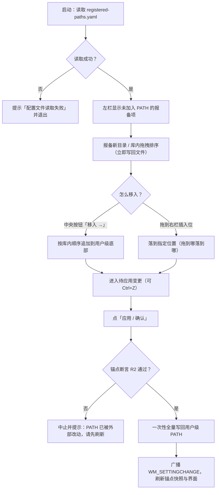
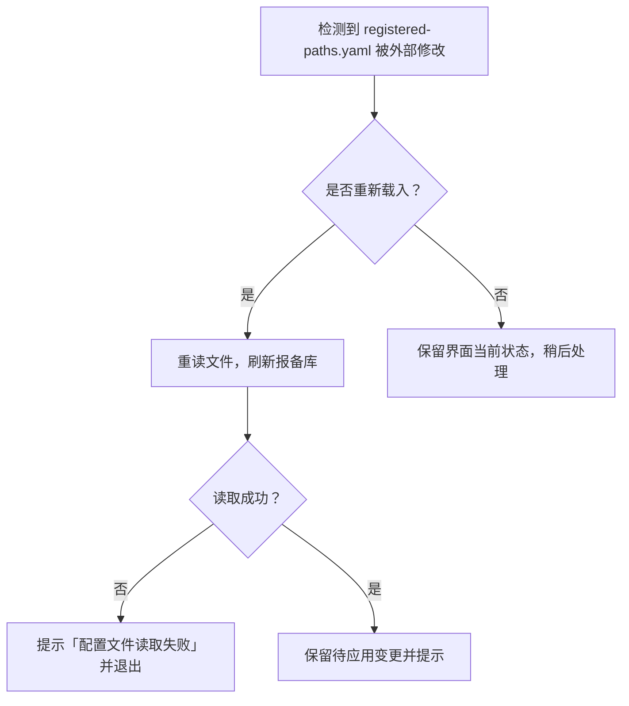
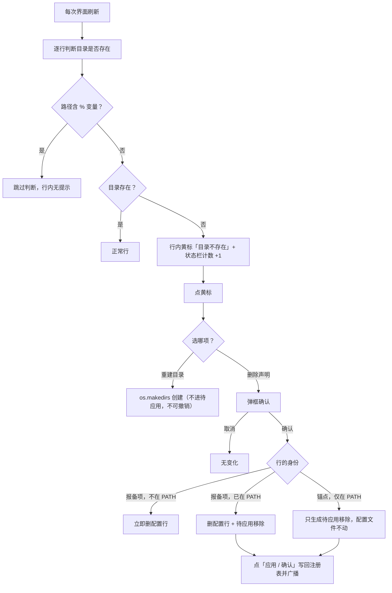
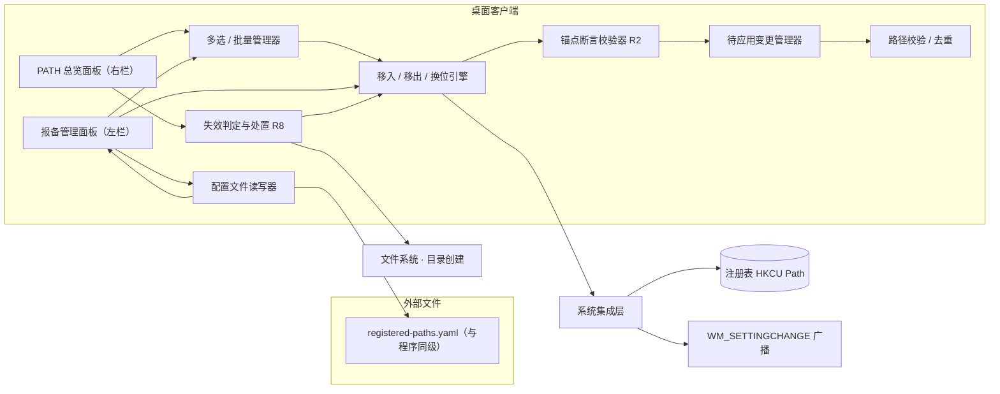

# 工具链 PATH 管理器 · 产品与设计文档

> **v1.1 · 重排版**（2026-11-19）
> 规则与结论没有变化，只重新组织：先讲清楚"它是什么、怎么用"，再展开规则、界面、实现与验收。

| 项目 | 内容 |
| --- | --- |
| 目标平台 | Windows 桌面（其他系统启动即报错退出） |
| 形态 | 原生 GUI（Python + PySide6，单文件 `tool2path.py`）+ 外部配置文件驱动 |
| 对应实现 | `tool2path.py`（单文件） |
| 规则编号 | R0–R8（实现与测试直接引用，改规则时请同步第 3 章） |
| 版本 | v1.1（规则定稿 2026-09-15；本版 2026-11-19 仅重新编排） |

**怎么读这份文档**

- 只想把工具用起来 → 读第 0、4、5 章。
- 想知道"为什么这样设计、哪些不能动" → 读第 3 章（规则）与第 9 章（边界）。
- 想改代码或做验收 → 读第 6、7、8、12 章。

---

## 0 一页看懂

### 0.1 它是什么

一句话：**把散落在各处的工具链「可执行入口目录」集中登记在一个文本文件里，再按需把它们放进用户级 PATH，随时能安全地拿进拿出。**

它解决三件事：

- **管理零散**：Node、Python、JDK、Go、FFmpeg……入口目录到处都是，没有统一的登记视图。
- **切换困难**：不同项目要不同版本 / 不同启用组合，手改环境变量既慢又容易出错，而且往往一组一组地切。
- **配置不透明**：工具清单应该是可读、可手改、能进 Git 的文本，而不是锁在某个私有数据库里。

同时它要防住最大的风险：**直接编辑 PATH 很容易误删或误移系统原有的关键路径**。所以未报备的路径一律锁定。

### 0.2 心智模型：记住三个东西

| 东西 | 是什么 | 在哪里 |
| --- | --- | --- |
| **配置文件**（报备库 / 白名单） | 一份只有目录路径的清单，是"我管哪些目录"的唯一事实源 | 与程序同级的 `registered-paths.yaml` |
| **用户级 PATH** | 真正决定命令能否被找到的路径序列 | 注册表 `HKCU\Environment\Path` |
| **锚点** | PATH 里存在、但没有登记在配置文件中的路径，只读，顺序永远不变 | 右栏置灰行 |

```
        ┌──────────────────────────┐
        │  registered-paths.yaml   │  ← 你也可以用编辑器直接改
        │  报备库（可操作白名单）    │
        └────────────┬─────────────┘
            读 / 立即写回
                     │
             ┌───────▼────────┐   点「应用」   ┌───────────────────────────────┐
             │    本软件 GUI   │ ────────────▶ │  用户级 PATH（注册表 HKCU）     │
             │  左栏  │  右栏  │ ◀──────────── │  HKCU\Environment\Path        │
             └────────────────┘   启动时读取    └───────────────────────────────┘
```

一句话区分左右栏：

- **左栏回答"我管哪些目录"**（配置文件视图）。
- **右栏回答"PATH 现在长什么样、我要把它调成什么样"**（注册表视图）。

| 对比项 | 左栏「报备库」 | 右栏「PATH 总览」 |
| --- | --- | --- |
| 数据来源 | 配置文件 | 注册表用户级 PATH |
| 显示内容 | **只显示还没进 PATH 的报备项** | 全部：锚点 + 已加入 PATH 的报备项 |
| 顺序含义 | 库内顺序（只影响展示与批量移入的先后） | PATH 生效顺序 |
| 改动何时生效 | 拖拽排序、增删报备 **立即写文件** | 只有点「应用 / 确认」才写注册表 |

### 0.3 三步上手

1. **报备**：把入口目录写进配置文件（左栏「＋ 报备新目录」）。写入后这个目录就"归本软件管"了。
2. **移入**：把它放进 PATH。默认用中央按钮追加到用户级底部；也可以直接把左栏条目拖到右栏某个位置。
3. **应用**：点底部「应用 / 确认」，一次性全量写回注册表，对之后新开的程序立即生效。

**移出**就是反过来：右栏选中后点「← 移出」，或直接把右栏报备行拖回左栏。移出后记录**回到报备库**，随时可以再移入。

### 0.4 九条规则速记

| 编号 | 一句话 | 关键边界 |
| --- | --- | --- |
| R0 | 配置文件就是报备库，界面只是它的编辑器 | 读不出来就提示并退出，绝不用空清单覆盖 |
| R1 | 只有报备过的路径才能动 | 未报备 = 只读锚点；唯一例外是失效锚点的删除 |
| R2 | 锚点之间的相对顺序永远不变 | 每次落盘前自动断言，失败即中止 |
| R3 | 左栏随便排，排序立即写回文件 | 不进入待应用，也不影响 PATH 顺序 |
| R4 | 批量操作整组移动，组内顺序不变 | 移入按库序，移出按右栏显示序 |
| R5 | 右栏只有报备行能拖 | 可拖到插入位，也可拖回左栏 = 移出 |
| R6 | 同一目录只允许报备一次 | 报备时去重，移入时判重 |
| R7 | PATH 改动先攒着，点「应用」一次写回 | 仅待应用阶段可 `Ctrl+Z` |
| R8 | 失效目录可「重建」或「删除声明」 | 删除只删登记，绝不删磁盘文件 |

---

## 1 背景与目标

### 1.1 用户痛点

- **管理零散**：入口目录分布在安装目录、SDK 目录、本地 bin 等各处，缺乏统一登记视图。
- **切换困难**：切换版本 / 启停工具链往往是一组一组地改 PATH，手动改又慢又易错。
- **配置不透明**：希望清单可读、可手改、可随 dotfiles / 仓库走，而不是锁在私有数据库里。
- **误删误动风险**：直接编辑 PATH 容易误删或误移系统关键路径，造成环境不可用。

### 1.2 目标

- 报备清单由**外部配置文件**驱动：与程序同级、内容仅为目录路径列表、可手改、可版本管理。
- 配置文件是**唯一事实源**：界面增删改排全部写回文件。
- 左 / 中 / 右三区界面；左右栏都支持多选与批量操作，批量保持所选相对顺序。
- 支持**左 ↔ 右双向跨栏拖拽**：左拖右 = 移入，右拖左 = 移出。
- 未报备路径是**固定锚点**：不可排序、移动、删除、多选。
- 写回模型简单可靠：改动集中预览，一次性全量写回，待应用阶段可撤销。

### 1.3 非目标（本次不做）

- 不做通用「环境变量编辑器」，不接管 PATH 之外的其他变量。
- 不做对非报备路径的任何排序 / 重排。
- 不做与外部 PATH 变更的自动合并 / 冲突协商。
- 不做远程 / 云端同步（配置文件本身可手工同步到其他机器）。
- 不自动探测「机器上装了哪些工具链」——只管理配置文件里登记的项。
- **不管理系统级（HKLM）PATH**：不设系统级开关、无跨层、无提权流程。
- **不删除磁盘上的任何文件或目录（硬约束）**：本软件所说的「删除」一律指移除一条**声明**（配置行 / PATH 条目）。

失效目录处置（R8）范围之外也明确不做：启动弹窗、失效项汇总窗口、跳过 / 忽略机制、批量重建或批量删除入口、命令行开关、失效原因分类与原因文案、目录内容与可执行文件校验、目录恢复后自动改动待应用变更，也不新增任何落盘文件。

---

## 2 核心概念

### 2.1 术语表

| 术语 | 定义 | 举例 |
| --- | --- | --- |
| **工具链** | 一个可独立启用的软件 / 解释器 / 框架集合 | Node.js、Python、JDK、Go、FFmpeg |
| **入口目录** | 工具链存放可执行文件的目录，即要写入 PATH 的目录，也是配置文件中的一行 | `C:\Program Files\nodejs` |
| **配置文件 / 报备库** | 与程序同级的报备清单文件，内容仅为路径列表，是报备库的唯一事实源 | `registered-paths.yaml` |
| **报备** | 把某入口目录写入配置文件。**报备即接管**：原本已在 PATH 中的路径一经报备也变为可操作项 | 在文件里新增一行 |
| **库内顺序** | 配置文件的行序；可任意拖拽重排并立即写回，与 PATH 生效顺序无关 | 左栏拖拽整理 |
| **多选** | 在左栏或右栏内同时选中多条可操作项；锚点不可选 | Ctrl / Shift / 勾选 |
| **批量操作** | 对一组选中项执行一次统一动作（移入 / 移出 / 整组换位），组内保持相对顺序 | 多选后点「移入 →」 |
| **锚点** | PATH 中未登记在配置文件、系统原本就存在的路径；**只读**：不可排序、移动、删除、多选 | System32、`%AppData%\npm` |
| **插入位** | 锚点序列中的可插入空隙：最顶部、任意两个锚点之间、最底部 | 拖动落点 |
| **用户级 PATH** | 仅当前用户生效的 PATH，存于 `HKCU\Environment\Path`，修改无需管理员；本软件唯一管理的层 | 右栏总览 |
| **移入** | 把报备项放进用户级 PATH 底部（中央按钮），或拖入右栏任意插入位 | 「移入 →」/ 跨栏拖拽 |
| **移出** | 把右栏选中的报备项从 PATH 移除，并写回报备库文件末尾 | 「← 移出」 |
| **拖入即移入** | 左栏条目直接拖到右栏某插入位，拖到哪落到哪 | 左 → 右拖拽 |
| **拖回即移出** | 右栏报备行直接拖回左栏即生成移出（落插入位或追加文件末尾）；锚点不可拖 | 右 → 左拖拽 |
| **待应用变更** | 尚未写回注册表的 PATH 改动集合（内存态），由「应用 / 确认」统一全量落盘；此阶段可用 `Ctrl+Z` 撤销 | 底部状态条 |
| **锚点不变** | 任何操作都不得改变未报备路径之间的相对顺序（剥离报备项后与最近快照一致） | 每次落盘前断言 |
| **失效目录** | 声明了（报备库中 / PATH 中）但当前不在磁盘上的目录；含 `%VAR%` 的路径不参与判定 | `D:\Ruby\bin`（已卸载） |
| **重建目录** | 用 `os.makedirs` 创建失效目录及其多级父目录，纯文件系统操作 | 换机后补建 `C:\Python312\Scripts` |
| **声明** | 一条被本软件管理的目录登记：配置行或 PATH 条目；「删除声明」只移除登记，不动磁盘 | 删配置行 / 删 PATH 条目 |

### 2.2 行的两种身份

右栏的每一行只可能是两种身份之一，判据只有一条：**它在不在配置文件里**。

| | 锚点行 | 报备行 |
| --- | --- | --- |
| 徽标 | 「系统原有 / 用户原有 · 锚点」 | 「报备」 |
| 可勾选 | 否 | 是 |
| 可拖动 / 可排序 | 否 | 是（可整组） |
| 可移出 / 可删除 | 否 | 是 |
| 唯一可交互点 | 目录失效时的「目录不存在」黄标 | 全部操作 |

- 报备一条**已经在 PATH 中**的路径，不需要先移出，直接接管（会提示「该目录已在 PATH 中，报备后将可管理」）。
- 同一目录同时存在于库和 PATH 时，左栏只显示未加入的条目，因此右栏只会出现一行。
- 左栏则相反：**只显示尚未加入 PATH 的报备项**，已加入的汇入右栏。

### 2.3 插入位

报备项在 PATH 中只能落在锚点之间的空隙里，不能把锚点"挤走"。插入位分三种：

- `top`：整个序列最顶部；
- `between:anchorIndex`：任意两个锚点之间；
- `bottom`：整个序列最底部（中央按钮「移入 →」的默认落点）。

---

## 3 业务规则（R0–R8）

> 这一章是全部交互与实现的逻辑根基，任何新功能不得违反。每条规则都写成「一句话 + 实施细则 + 例外」。

### 3.1 一览

| 规则 | 名称 | 一句话 |
| --- | --- | --- |
| R0 | 配置文件即报备库 | 文件是唯一事实源，界面只是它的可视化编辑器 |
| R1 | 报备即接管 | 只有报备过的路径可操作，其余是只读锚点 |
| R2 | 锚点不变 | 未报备路径的相对顺序在任何操作后都不变 |
| R3 | 库内自由排序 | 左栏任意排序，实时写回文件，与 PATH 无关 |
| R4 | 组序不变 | 批量操作把选中集当一组，组内相对顺序不变 |
| R5 | 右栏拖动规则 | 只有报备行能被拖动，可落插入位或拖回左栏 |
| R6 | 唯一性 | 同一目录只报备一次；移入前判重 |
| R7 | 待应用与全量回写 | PATH 改动先进待应用，点「应用」一次全量写回 |
| R8 | 失效目录行内处置 | 失效行提供「重建目录 / 删除声明」两个动作 |

### 3.2 R0 · 配置文件即报备库

- 配置文件是报备库的唯一事实源：左栏只展示文件内容；「报备新条目 / 删除报备 / 库内拖拽排序 / 移出回库」都会**写回该文件**（保持"仅路径数组"结构，排序 = 重排行序）。
- 启动时读取；**读不出来**（权限、被占用、格式损坏、网络盘断开）一律弹窗「配置文件读取失败」并退出程序，**不做任何内存态改写，绝不用空清单覆盖报备库**，不存在"空报备库"的中间态。
- 文件不存在时：首次启动自动创建空清单（含头部注释）并提示。
- GUI 写回只重写路径列表区，尽量保留文件头部注释；写入为**直接整文件覆写**（进程内加锁），不生成 `.bak` / `.tmp`。
- 外部编辑器改动文件时提示「配置文件已被外部修改，是否重新载入？」，**不自动覆盖界面当前状态**。

### 3.3 R1 · 报备即接管（白名单）

- 对 PATH 中的某条路径执行「移出 / 删除 / 拖动换位 / 多选批量操作」，前提是它登记在配置文件中。
- 未报备路径是只读锚点：**不可排序、不可移动、不可删除、不可选**；即便程序内部收到指令也拒绝，提示「锚点路径不可操作」。
- 报备原本已在 PATH 中的路径时，直接显式接管，无需先移出。
- **唯一例外**：已判定失效的锚点行可经行内黄标删除（见 R8.4），必须经确认框，并走待应用机制。

### 3.4 R2 · 锚点不变

- 未报备路径构成**固定锚点序列**。软件自身的任何操作（含批量移入、移出、整组拖动、应用）都不得改变锚点之间的相对顺序。
- 判定方式：**剥离所有报备路径后，剩余序列必须与最近一次读取的快照完全一致**，作为每次落盘前的自动断言。
- 报备路径只能落入插入位，不能把锚点"挤走"。
- 快照刷新时机：启动、手动「刷新」、每次成功应用之后。对外部 PATH 变更不做冲突协商（见 R7）。
- **同一处窄例外**（见 R8.4）：用户显式删除失效锚点时，锚点集合本身减少一项；断言仍按"剥离后与快照一致"比对，其余锚点相对顺序不变。

### 3.5 R3 · 库内自由排序

- 配置文件行序即库内顺序。左栏支持**任意拖拽排序**（含多选整段拖移），排序**实时写回配置文件**。
- 排序**不进入「待应用变更」**，不需要点「应用」。
- 库内顺序只影响清单展示与「批量移入」时的先后次序，**不影响、也不构成** PATH 的任何顺序。
- 拖拽无层级 / 约束限制；报备行拖回后也按库序参与排序。
- 手工编辑文件换行顺序 = 换库内顺序，重新载入后生效。

### 3.6 R4 · 批量操作保持组序

任何批量操作都把多选集合视为**一组**：组内相对顺序不变，整组作为一个整体落到目标位置。

| 操作 | 组内顺序取自 | 落到哪里 |
| --- | --- | --- |
| 批量移入（中央按钮） | **库内顺序** | 作为一条连续块追加到用户级底部 |
| 批量移出（中央按钮） | **右栏当前显示顺序** | 从 PATH 移除，按该顺序追加到配置文件末尾 |
| 整组拖动换位 | 右栏当前显示顺序 | 指定插入位，组序不变 |
| 整组拖回左栏（拖回即移出） | 右栏当前显示顺序 | 落到插入位则插入配置文件对应位置；落到空白区则追加到文件末尾 |

### 3.7 R5 · 右栏拖动规则

- 右栏中**只有报备行可拖拽**（可多选后整组拖），落到任意插入位（拖到哪落到哪），或**反向拖回左栏生成移出**。
- 锚点不可拖、不可选。
- 报备项之间可互相排序，排序后锚点序列不受影响。
- 移动 = 先从原插入位摘除、再插入新插入位（与 R6 的唯一性一致）。

### 3.8 R6 · 唯一性

- **报备阶段**：同一绝对路径（不区分大小写、去尾部空格与反斜杠）在配置文件中只允许一条；GUI 报备时去重并提示「该目录已报备」；手工写入的重复行在读取时标记「重复（只显示一条）」并报告行号。
- **移入阶段**：移入前检查 PATH 中是否已存在该路径；已存在则置为「已加入」，不产生重复变更。批量移入时逐条判重，重复项在确认清单中列出并跳过，**不拆散组序**。

### 3.9 R7 · 待应用与一次全量写回

- 右栏的移入 / 移出 / 换位**只改内存模型**并进入**待应用变更**；批量操作展开为多条 PendingChange，共享 `groupId`，支持整组撤销。
- 配置文件（报备库）的增删改排**直接写文件**，不进入本机制。
- 只有点底部「应用 / 确认」才写注册表：**一次性全量写回用户级 PATH 整键**，成功后广播 `WM_SETTINGCHANGE`。无需提权，不做外部变更冲突协商。
- 落盘前自动断言 R2；断言失败即中止，提示「PATH 已被外部程序改动，请先刷新」。
- **撤销仅限待应用阶段**：`Ctrl+Z` 撤销最近一条或整组（撤销整组时二次提示）；落盘后不提供快照回滚，也没有操作日志。
- 「退出」与窗口 × 等价：放弃全部待应用变更并关闭；存在待应用变更时先弹确认（配置文件的改动已即时保存，不受影响）。

### 3.10 R8 · 失效目录行内处置

一句话：**对判定为失效的目录行（报备项与锚点一视同仁），行内提供「重建目录」与「删除声明」两项处置。重建只建目录，删除只删声明，两者都不碰磁盘上的已有内容。**

#### R8.1 判定与呈现

判定只有一问：这个目录现在在不在磁盘上。

1. 路径含 `%`：不参与判定，不提示（`%USERPROFILE%\npm` 这类合法锚点不会被误报）。
2. 其余情况：`os.path.isdir(path)` 为真即正常，为假即失效；不区分、也不解释失效原因。
3. 目标路径被同名**文件**占位也判为失效；重建会因同名文件失败并提示，程序不覆盖文件。

- 判定在**每次界面刷新时重算**，不新增检查按钮或定时器。
- 失效行行内显示可点的「目录不存在」黄标；状态栏显示「N 个目录不存在」，计数含左栏失效报备、右栏失效报备与失效锚点，为 0 时不显示。

#### R8.2 重建目录

- 用 `os.makedirs(path, exist_ok=True)` 创建目录及多级父目录（整条被删掉时一次建回来）。
- 成功：静默刷新界面，黄标消失。失败：弹错误框并回显原因（同名文件占位、无写入权限等）。
- 重建是文件系统操作：**不进待应用、不可撤销**，也不写注册表。

#### R8.3 删除声明

先弹框确认，确认后按行的身份分三种实现：

| 行的身份 | 菜单文案 | 实现 | 落盘时机 | 撤销 |
| --- | --- | --- | --- | --- |
| 失效报备，不在 PATH（左栏行） | 删除声明 | 删配置行并即时写回文件 | 立即 | 无 |
| 失效报备，已在 PATH（右栏行） | 移出并删除声明 | 删配置行 + 生成一组待应用移除 | 点「应用 / 确认」 | `Ctrl+Z` 整组撤销 |
| 失效锚点，仅 PATH（右栏行） | 删除声明 | 只从工作序列移除该行并生成待应用组，配置文件完全不动 | 点「应用 / 确认」 | `Ctrl+Z` 撤销 |

黄标菜单的三个分支只有第二项不同，第一项始终是「重建目录」：

```
   报备项且不在 PATH        报备项且已在 PATH           失效锚点
   ┌──────────────┐        ┌──────────────────┐      ┌──────────────┐
   │ 重建目录      │        │ 重建目录          │      │ 重建目录      │
   │ 删除声明      │        │ 移出并删除声明     │      │ 删除声明      │
   └──────────────┘        └──────────────────┘      └──────────────┘
```

确认框正文统一，第二句按目录现状自适应：

> 将从声明中移除「{name}」，路径 {entry_dir}。
> - 目录仍在磁盘上（或含 `%VAR%` 无法判定）：「仅移除声明，不会删除磁盘上的任何文件或目录。」
> - 目录不在磁盘上：「该目录当前不在磁盘上，删除仅移除这条登记。」（失效项本就没有磁盘文件可删，不再提磁盘，避免噪音）

右栏报备行的确认框额外补一句：**若在应用前退出，该路径仍在 PATH 中，但已失去报备身份（变回锁定锚点）。**

左栏右键「删除声明」与右栏右键「移出并删除声明…」复用同一套文案。

#### R8.4 这是 R1 / R2 的窄口径例外

这是软件唯一能改动锚点集合的地方，边界限定如下：

- 只在目录已不存在时出现；
- 只由用户点菜单触发；
- 必须经过确认框；
- 必须走待应用机制；
- 实现上**不经过「报备接管」**，配置文件完全不动，用户不会因为一次删除而在报备库里多出条目。

R2 的断言逻辑不需要改动：行被移除后不再出现在工作序列中，期望锚点集合自然不含它，其余锚点相对顺序不变，断言照旧通过；`Ctrl+Z` 由既有待应用快照恢复该行。

#### R8.5 不做的事

不提供跳过 / 忽略；不提供批量重建或批量删除入口；不提供命令行开关；不在探测到目录恢复存在时自动改动待应用变更；不新增任何落盘文件。

#### R8.6 与既有规则的关系

- R0 一致：删报备项走既有的删行 + 保存流程，头部注释照旧保留；删锚点不碰文件。
- R1 / R2：各登记一处窄例外（见 R8.4），例外被刻意限定在"目录不存在"的行上，且**不采用"先报备再删除"来绕过**。
- R3–R7 无影响：不涉及库序、不构成批量组序操作、不涉及拖拽、按规范化路径归并、PATH 侧移除全部进待应用。

---

## 4 界面与操作

### 4.1 布局

主窗口为「左报备库 / 中央移入移出 / 右 PATH 总览」三区布局。左栏标题旁标注配置文件位置，底部为应用操作条，顶栏提供全局搜索 / 过滤框（作用于右栏）。

```
┌──────────────────────────────────────────────────────────────────────────────┐
│ 工具链 PATH 管理器                              [过滤 PATH…] [⟳ 刷新]        │
├──────────────────────┬──────────┬────────────────────────────────────────────┤
│ 报备库(配置文件)      │          │ ● 用户级 PATH · 本用户生效                │
│ registered-paths.yaml│          │  ─ 插入位（顶部）─  ←拖入即落位           │
│ 未加入 3              │   移入 → │  ☑ [报备] nodejs              ⠿  ▲▼     │
│ ☑＋ 报备新目录       │（3 项→    │    C:\Program Files\nodejs               │
│ ☑ ⠿ Go 1.22          │  用户级底)│  [用户原有·锚点] npm 全局   ── 锁定 ───── │
│ ☑   C:\Go\bin        │          │    %AppData%\npm  （不可选，顺序固定）   │
│ ☑ ⠿ python           │   ← 移出  │  ─ 插入位 ─                              │
│ ☑   C:\Python312\Scripts│（2项)  │  ☑ [报备] python             ⠿  ▲▼     │
│ ☐ ⠿ ruby              │    ←←    │    C:\Python312\Scripts                  │
│     D:\Ruby\bin       │  拖回=   │  ─ 插入位（底部）─                        │
│ （左栏拖拽=库内排序   │   移出   │  （右栏报备行也可多选拖回左栏=移出）      │
│   写回配置文件；      │          │                                          │
│   拖到右栏=移入）     │          │                                          │
├──────────────────────┴──────────┴────────────────────────────────────────────┤
│ 已选 5 项 · 待应用 3 项 · Ctrl+Z 撤销                                       │
│ [应用]  [确认]  [退出]                                                      │
└──────────────────────────────────────────────────────────────────────────────┘
```

失效行只比正常行多一个可点的黄标按钮，其余交互不变。

### 4.2 四种拖拽，各管一件事

| 拖动方式 | 从哪到哪 | 结果 | 写配置文件 | 需要应用 |
| --- | --- | --- | --- | --- |
| 库内排序 | 左栏内上下拖 | 改库内顺序 | **立即** | 否 |
| 快捷移入 | 左栏 → 右栏插入位 | 按落点插入 PATH | 不改 | 是 |
| 右栏换位 | 右栏内拖动报备行 | 报备项换位置，锚点不动 | 不改 | 是 |
| 拖回即移出 | 右栏报备行 → 左栏 | 从 PATH 移除并回库 | **立即**（落插入位或追加末尾） | 是（PATH 侧） |

### 4.3 关键控件

| 控件 | 位置 | 行为 | 可用性 / 约束 |
| --- | --- | --- | --- |
| 勾选框 ☑ | 左右栏行首 | 单选 / 多选；`Shift` 范围选、`Ctrl` 增减、`Ctrl+A` 全选 | 左栏全部可用；右栏仅报备行可用 |
| 拖拽手柄 ⠿（左） | 左栏行首 | 库内任意拖拽排序（含多选整段），实时写回文件 | 所有未加入条目 |
| 左栏整行拖拽 | 左栏行身 | 拖进右栏 = 快捷移入（拖到哪落到哪） | 仅未加入条目 |
| 拖拽手柄 ⠿（右） | 右栏报备行 | 单行或整组拖到插入位，或拖回左栏 = 移出 | 仅报备行，锚点禁用 |
| ▲ / ▼ | 右栏报备行 | 单行在插入位间上移 / 下移一格（进待应用） | 仅报备行 |
| 插入位 | 锚点之间 / 两端 | 展示可落位空隙，高亮当前目标位 | 展示性；锚点不可被替换 |
| 移入 → | 中央按钮列（上） | 选中组 → 追加用户级底部，按库序连续块（待应用） | 左栏有选中项时可用，显示数量 |
| ← 移出 | 中央按钮列（下） | 选中报备组 → 移出 PATH，按右栏序写回文件末尾（待应用） | 仅"报备且已在 PATH"的选中项 |
| 目录不存在 ▾ | 失效行状态区 | 点开两项菜单：重建目录 / 删除声明 | 仅失效行渲染 |
| 重建目录 | 行内菜单第一项 | 创建目录及多级父目录，成功后静默刷新；失败弹框 | 始终可用（不写注册表） |
| 删除声明 / 移出并删除声明 | 行内菜单第二项 | 确认后按 R8.3 分三种实现落盘 | 写盘期间禁用 |
| ＋ 报备 | 左栏顶部 | 浏览 / 粘贴 / 多行批量报备，追加到文件末尾 | 配置已成功加载时可用 |
| 删除声明 | 左栏右键菜单 | 从配置文件删除该行；在 PATH 中时确认后"移出并删除声明" | 仅报备库条目 |
| ⟳ 刷新 | 顶栏 | 重读配置文件 + 注册表，重扫目录存在性；有待应用先确认再放弃 | 始终可用（写盘期间禁用） |
| 应用 / 确认 / 退出 | 底部 | 应用 = 全量写回并停留；确认 = 写回并关闭；退出 = 放弃并关闭 | 按 R7 |
| Ctrl+Z | 全局 | 撤销最近一条 / 整组待应用变更 | 有待应用变更时可用 |

补充约束：

- **编辑（重设路径）**：仅允许**不在 PATH 中**的报备项；在 PATH 中的条目会被拒绝并提示先「移出」（避免与 PATH 语义冲突）。
- **报备表单只填目录**：显示名由目录末级派生（`C:\Program Files\nodejs` → `nodejs`），同名条目以完整路径区分，文件中不含名称字段。
- **允许登记当前不存在的目录**：缺失只标黄，不阻断保存。

### 4.4 什么操作写哪个"盘"

这张表能回答绝大部分"为什么我改了没生效"的问题：

| 操作 | 配置文件 | 注册表 PATH |
| --- | --- | --- |
| 报备新目录 / 删除声明（不在 PATH） | 立即写 | 不写 |
| 左栏库内排序 | 立即写 | 不写 |
| 移入（按钮 / 拖入） | 不改（仍在库中） | 待应用 |
| 移出（按钮 / 拖回） | 立即写回末尾或插入位 | 待应用 |
| 右栏内换位 | 不改 | 待应用 |
| 删除声明（不在 PATH） | 立即删行 | 不写 |
| 删除声明（在 PATH） | 立即删行 | 待应用 |
| 删除失效锚点 | 完全不动 | 待应用 |
| 重建目录 | 不改 | 不改（只建目录） |
| 刷新 | 重读 | 重读（放弃待应用） |
| 应用 / 确认 | — | 立即全量写 + 广播 |

### 4.5 状态与提示文案

- 底部状态条：`已选 N 项 · 待应用 N 项 · Ctrl+Z 撤销`。
- 左栏顶角：`报备库 · 未加入 N 项`（已加入的条目汇入右栏）。
- 状态栏：`N 个目录不存在`（含左右栏失效报备与失效锚点，为 0 不显示）。
- 行内：`目录不存在` 黄标（可点）。
- 弹窗：
  - `配置文件读取失败`（并退出程序）
  - `配置文件已被外部修改，是否重新载入？`
  - `放弃 N 项待应用变更并退出？`
  - `该目录已报备` / `该目录已在 PATH 中，报备后将可管理`
  - `锚点路径不可操作`
  - `PATH 已被外部程序改动，请先刷新`
  - `PATH 长度接近上限，仍然写入 / 放弃该项`

---

## 5 典型场景与流程

### 5.1 场景速查

| 场景 | 怎么做 | 结果 |
| --- | --- | --- |
| 首次启用某个工具链 | 报备目录 → 点「移入 →」→ 应用 | 追加到用户级底部，新开的程序立即可用 |
| 手工编辑配置文件 | 用编辑器加 / 删一行 → 软件提示外部改动 → 重新载入 | 界面与文件保持一致，不会互相覆盖 |
| 整理报备库 | 左栏任意拖拽 | 顺序实时写回文件，不影响 PATH |
| 批量启用一组 | 左栏勾选多个 → 移入 | 按库序作为连续块追加到 PATH 底部 |
| 拖到指定位置启用 | 左栏条目直接拖到右栏某插入位 | 拖到哪落到哪 |
| 临时停用 / 批量移出 | 右栏选中 → 移出 | 回到配置文件末尾，仍在报备库，随时可再移入 |
| 整组调整位置 / 提级 | 右栏多选 → 拖到顶部或某插入位 → 应用 | 组序不变，锚点不动 |
| 反向拖回停用 | 右栏报备行拖回左栏 | 落位即回库，应用后从 PATH 移除 |
| 配置随身走 | 把 `registered-paths.yaml` 放进 dotfiles 仓库 | 新机器同目录启动即得到同样的报备清单 |
| 误操作补救 | `Ctrl+Z` 撤销待应用变更 | 配置文件的改动需手工恢复（可依赖版本管理） |
| 保护系统核心路径 | 直接使用（不报备） | 未登记路径是锚点，不可勾选、不可拖动 |
| 卸载残留清理 | 失效行黄标 → 删除声明 | 配置行 / PATH 条目被移除，磁盘不受影响 |
| 换机后重建 | 失效行黄标 → 重建目录 | 多级目录一次建好，黄标消失 |
| 死掉的 PATH 垃圾 | 失效锚点黄标 → 删除声明 → 应用 | 从 PATH 移除（配置文件不动） |
| 误删后反悔 | `Ctrl+Z` | 撤销那一组待应用变更，行回到原位置 |
| 恢复到某套组合（远期） | 用不同配置文件切换 | 未排期，见第 11 章 |

### 5.2 主流程：报备 → 移入 → 应用



### 5.3 应用 / 确认 / 退出

- **应用**：全量写回，成功后广播并重读刷新快照，窗口保持打开。
- **确认**：同「应用」，成功后关闭。
- **退出 / ×**：放弃全部待应用变更并关闭；有待应用变更时先弹确认。
- 写回前依次做三件事：断言 R2 → 预估 PATH 长度（超限警告，由用户决定「仍然写入 / 放弃该项」）→ 一次写整键。
- 写入失败：提示失败项，界面保持可修正状态。

### 5.4 配置文件被外部修改



注意两种"重读"不是一回事：

- **外部改动提示里的"重新载入"**：只重读配置文件，不动右栏与待应用变更。
- **顶栏「刷新」**：重读配置文件 + 重读注册表 + 重扫目录存在性；待应用变更会被放弃（有变更时先确认）。

### 5.5 失效目录：从发现到处置



---

## 6 配置文件（唯一事实源）

### 6.1 位置与格式

- 文件名 `registered-paths.yaml`（纯文本，UTF-8），与程序可执行文件**同级**，便于随手打开编辑、随 dotfiles 走。
- 内容**仅为一个目录路径数组**：每行一个条目，支持注释行与空行；**不含** id、名称、排序号、备注、时间戳等任何字段。
- 文件行序 = 库内顺序；同一规范化路径（小写、去尾部空格与反斜杠）只允许出现一次。

```yaml
# Toolchain Path Manager - 已报备的工具链入口目录
# 每一行 = 一个入口目录；顺序 = 报备库内顺序；可手工编辑后在本软件中重新载入
- C:\Program Files\nodejs
- C:\Python312\Scripts
- D:\Ruby\bin
```

### 6.2 读写与同步

| 关注点 | 做法 |
| --- | --- |
| 启动 | 读取；失败则弹窗并退出，不做任何内存态改写 |
| 文件缺失 | 首次启动自动创建空清单（含头部注释）并提示 |
| 解析 | 容错：跳过注释、空行与 `---`；重复路径去重并报告行号 |
| 写回 | 只重写路径列表区，尽量保留头部注释；整文件直接覆写（进程内加锁），不留临时文件 |
| 外部改动监测 | 轮询修改时间与大小签名（秒级）；发现改动提示「是否重新载入？」，不自动覆盖 |
| 手动「刷新」 | 重读配置 + 重读注册表 + 重扫存在性；放弃待应用变更（先确认） |
| 路径规范化 | 去尾部空格与反斜杠、大小写不敏感判重（R6） |

### 6.3 显示名

- 由目录末级派生（`C:\Program Files\nodejs` → `nodejs`），同名条目以完整路径区分。
- 显示名**不落盘**，配置文件中没有名称字段。

---

## 7 数据模型

### 7.1 配置文件

- 一个字符串数组，每行一项；元素是路径原文。
- 行序即库内顺序；不含任何元数据。

### 7.2 Toolchain（运行期对象，由配置行派生，不落盘）

| 字段 | 含义 |
| --- | --- |
| `entryDir` | 目录路径（文件行原文） |
| `displayName` | 派生显示名（目录末级，同名以完整路径区分） |
| `sortOrder` | 由文件行序推导（重排即写回文件） |
| `createdAt` | 会话内新增时间，仅用于本会话提示，不持久化 |

### 7.3 PathEntry（右栏一行，每次从注册表重建）

| 字段 | 含义 |
| --- | --- |
| `kind` | `anchor`（未报备锚点，只读）/ `managed`（报备项，可操作） |
| `value` | 原始路径字符串 |
| `index` | 在锚点序列中的原始序号（锚点之间的相对顺序固定） |
| `registeredDir` | 若为 managed，等于配置文件中的对应目录 |
| `selectable` | 是否可勾选 / 拖动（managed 为 true，anchor 为 false） |

**不变量**：所有 `anchor` 的相对顺序 == 最近快照（R2）。

### 7.4 Selection 与 PendingChange

- **Selection（UI 态）**：左右栏各自维护多选集合，锚点不可进入；按面板显示顺序排序。
- **PendingChange（一条待应用 PATH 变更）**：

| 字段 | 含义 |
| --- | --- |
| `op` | `insert` / `remove` / `move` / `unregister`（删除配置行，仅随 remove 成组出现） |
| `path` / `registeredDir` | 目标目录 |
| `slot` | 插入位：`top` / `between:anchorIndex` / `bottom`；反向拖回时另有配置文件落位 `configSlot` |
| `groupId` | 同一次批量操作的共享组号（整组预览 / 撤销 / 失败定位） |

配置文件的增删改排**不属于** PendingChange（反向拖回的"回库"部分即配置文件写回）。

### 7.5 两个事实源的分工

- `registered-paths.yaml` = 报备库事实源（"本软件管理的物"），GUI 即时读写。
- 注册表 PATH = PATH 现状事实源（"锚点 + 已加入报备项"的可推导视图），仅经「应用 / 确认」全量写回。
- 一致性：配置文件里的目录不一定在 PATH（左栏）；PATH 中的报备行一定在配置文件（右栏）。

---

## 8 架构与技术方案

### 8.1 技术栈与取舍

**Python + PySide6，单文件实现 `tool2path.py`**。注册表读写直接用 `winreg` + `ctypes`，与"只写用户级 PATH、无需提权"的形态匹配；核心规则引擎为纯 Python，可脱离 GUI 跑自动化测试，因此 UI 框架替换不影响规则实现，`requirements.txt` 仅 PySide6。

| 备选方案 | 未采用的原因 |
| --- | --- |
| Tauri (Rust) | 体量小、能调原生注册表 API，但需额外维护 Rust 工具链，单文件小工具收益不足 |
| .NET WPF / WinForms | 注册表与 UI 成熟，但工程与分发体积明显更大 |
| Electron | 前端灵活，但体积大，写注册表仍需原生模块 |

已知取舍：打包分发较重、UI 观感一般；平台仅支持 Windows（非 Windows 启动即报错退出，不提供预览模式）。自动化测试通过注入内存假注册表（`FakeRegistry`）进行，不触碰真实 `HKCU`。

### 8.2 模块划分



要点：两个事实源职责分离；左 ↔ 右双向拖拽都经过移入 / 移出引擎；失效处置分两路——重建只落到文件系统，删除经由引擎进入待应用。

### 8.3 权限

- 只写用户级 PATH（`HKCU\Environment\Path`），普通权限即可，**无提权、无 UAC 流程**。
- 无管理员子进程、无系统级写入分支，架构因此大幅简化。

### 8.4 用户级 PATH 读写要点

| 关注点 | 实现要点 |
| --- | --- |
| 键位 | `HKCU\Environment` → `Path` |
| 分隔符 | `;` |
| 类型 | 保持 `REG_EXPAND_SZ` 与 `REG_SZ` 不被互相破坏：写入原始值，不做展开改写 |
| 写后广播 | `SendMessageTimeout(HWND_BROADCAST, WM_SETTINGCHANGE, 0, "Environment", SMTO_ABORTIFHUNG, …)`；在后台线程广播，避免无响应窗口占满超时冻结界面 |
| 全量写回 | 计算完整目标 PATH（锚点按快照顺序 + 报备项按插入位），整体写回该键 |
| 断言 | 写回前剥离报备项，断言锚点相对顺序与最近快照一致；不一致则中止并提示重读 |
| 超长防护 | 写回前预估长度，超过约 32000 字符时警告，由用户决定「仍然写入 / 放弃该项」 |
| 提交方式 | 一次写用户级整键，成功后广播；不调用 `RegFlushKey`（系统延迟刷盘），`CloseKey` 放在 finally |

### 8.5 与微软现行标准的符合性（2026-09-15 审查）

对照 Microsoft Learn 现行文档（Environment Variables、SendMessageTimeoutW）逐项核对，结论：**核心系统交互全部符合，无需整改**。

- 只写 `HKCU\Environment\Path`，普通权限，不触碰 HKLM 与其他键；
- 写后广播常量与 `SendMessageTimeoutW` 七参签名一致，lParam = `"Environment"`，且在后台线程执行；
- 读取用 `RegQueryValueEx` 语义（返回未展开原文），`REG_EXPAND_SZ` / `REG_SZ` 类型保真，字面写回 `%VAR%`，不使用 `setx`；新建值缺省 `REG_EXPAND_SZ`；
- 长度阈值 32000 字符 + 确认，相对文档上限 32767 属保守。

**已登记、暂缓实施的加固项**（均为罕见路径，改动量小）：

| 项 | 现状 | 建议改法 | 暂缓理由 |
| --- | --- | --- | --- |
| 键不存在时的兜底 | `winreg.CreateKey`（该 API 不接受访问掩码） | `CreateKeyEx(HKCU, "Environment", 0, KEY_SET_VALUE)` | `HKCU\Environment` 缺失极罕见 |
| 广播超时 | 3000ms | 对齐官方示例 5000ms | 广播在后台线程，差异不影响可用性 |
| 异常注册表类型容错 | Path 被第三方损坏为 `REG_BINARY` 等类型时，字符串写回会失败并提示 | 读取时对非 `REG_SZ` / `REG_EXPAND_SZ` 回退 `REG_EXPAND_SZ` 并提示一次 | 仅在注册表被外部损坏时触发，现有失败提示可定位 |

---

## 9 边界情况速查

| 场景 | 既定行为 |
| --- | --- |
| 配置文件不存在 | 自动创建空清单（含头部注释）并提示 |
| 配置文件读不出来（权限 / 占用 / 网络盘） | 启动、刷新、重新载入一律弹窗「配置文件读取失败」并退出，不改动任何内存态 |
| 配置文件里同一路径出现两次 | 读取去重只显示一条并提示；GUI 写入保证唯一 |
| 外部编辑器改了配置文件 | 提示「是否重新载入？」，不自动覆盖界面状态 |
| GUI 正在编辑时外部又改文件 | 保留界面当前状态并提示冲突，由用户选择（继续编辑则以界面为准覆盖文件） |
| 想排序 / 删除一条未报备路径 | 拒绝（锚点不可选、不可拖）；唯一例外是失效锚点的「删除声明」 |
| 报备一条已在 PATH 中的路径 | 直接接管为 managed，不重复追加 |
| 编辑一个已在 PATH 中的报备项 | 拒绝并提示先「移出」再改 |
| 删除一个在 PATH 中的报备项 | 统一确认文案 → 删配置行 + 生成待应用移除；应用前退出则该路径仍在 PATH 但失去报备身份 |
| 批量移入时混有已在 PATH 的目录 | 逐条判重跳过并列出，组序不拆散 |
| 批量移出时选中集混入锚点 | 锚点本就不可选；异常输入自动剔除 |
| 反向拖回时拖到已有报备项上 | 视为插入该项之前的插入位，不产生重复 |
| 外部程序改了 PATH，且存在待应用变更 | 不做冲突协商，全量写回；如需以注册表为准，点「刷新」（放弃待应用） |
| 落盘前断言失败 | 中止并提示「PATH 已被外部程序改动，请先刷新」 |
| 路径含 `%VAR%` | 不参与失效判定；按字面字符串比较、字面写入，不展开 |
| 失效路径被同名文件占位 | 判为失效；重建失败并提示同名文件已存在，不覆盖文件 |
| 失效路径多级父目录都不存在 | 重建一次补齐全部层级 |
| 写盘期间点开黄标菜单 | 删除项禁用；重建不写注册表，仍可执行 |
| 刷新时目录恰好恢复存在 | 黄标自动消失；已生成的待应用变更不受影响 |
| 删除后反悔 | 未应用则 `Ctrl+Z`；已应用则需重新报备或在系统设置里加回 |
| PATH 接近 / 超过上限 | 写回前预估长度，警告后由用户决定「仍然写入 / 放弃该项」 |
| 左栏排序后直接退出、没点应用 | 排序已即时写文件，不受影响；只放弃右栏待应用变更 |
| 同一目录同时在库与 PATH | 按规范化路径归并；左栏只展示未加入项，界面只会出现一行 |

---

## 10 风险与取舍

| 风险 | 影响 | 应对 |
| --- | --- | --- |
| 用户手工改坏配置文件 | 报备库不可用 | 读不出来即提示退出；宽容解析跳过坏行；不生成备份，建议纳入 Git / dotfiles |
| GUI 与外部编辑并发写文件 | 互相覆盖 | 进程内加锁 + 整文件覆写 + 外部改动提示；冲突交由用户选择 |
| 配置文件被误删 / 移动 | 报备库丢失 | 首次启动自动重建空文件并提示；建议版本管理 |
| 批量误操作 | 大面积 PATH 变更 | 批量预览 + 二次确认；待应用阶段可整组 `Ctrl+Z` |
| 外部 PATH 变更被全量写回覆盖 | 丢失外部配置 | 既定决策（R7）；锚点断言失败即中止，并保留「刷新」入口 |
| 待应用变更未保存即退出 | 操作丢失 | 退出 / × 前确认；异常退出不改注册表 |
| 应用后无法回滚 | 只能手动改回 | 仅待应用阶段可撤销（既定取舍，见 R7） |
| 双向拖拽误判目标面板 | 误移入 / 误移出 | 目标高亮 + 落点提示；反向拖回需落在左栏插入位或空白处 |
| 库内顺序与 PATH 顺序混淆 | 用户以为拖一下就改 PATH | 文案区分「库内顺序（写配置文件）」与「PATH 生效顺序（需应用）」 |
| PATH 超长损坏 | 命令不可用 | 长度预估 + 超限警告由用户决定 |
| 用户以为「删除」会清理磁盘 | 预期落空 | 确认框明确「仅移除声明，不会删除磁盘上的任何文件或目录」 |
| 用户以为重建能恢复工具链 | 目录建好但命令仍不可用 | 重建只建目录，不额外提示，靠使用说明交代边界 |
| 失效项长期无人处理 | 死条目累积 | 状态栏计数（>0 显示）+ 行内黄标；不提供忽略机制，不会被静默掩盖 |
| 锚点可删削弱 R1 / R2 的直观印象 | 后续维护者误以为锚点全面可写 | R8.4 写明窄例外边界，并在 R1 / R2 各留一条指针 |

---

## 11 待定与后续

**仍开放**

- **打包与分发**：免安装包 / 带 venv 的压缩包 / 保持源码 + `run.bat`——只影响发布形态，不涉及规则与交互。
- **注册表写入加固**：`CreateKeyEx` 兜底、广播超时对齐 5000ms、异常类型容错，见 8.5，已登记暂缓。

**已拍板，不再开放**

- 技术栈：Python + PySide6 单文件。
- 外部配置文件驱动：与程序同级、仅路径列表、唯一事实源；启动读 + 手动刷新 + 外部改动提示；整文件覆写，不产生临时文件。
- 只管理用户级 PATH，不管理系统级，无提权。
- 显示名由路径派生不落盘；报备表单只填目录。
- 报备即接管；锚点只读（唯一例外是失效锚点删除）；移出回文件末尾；按钮移入追加底部；跨栏拖拽"拖到哪落到哪"。
- 双向跨栏拖拽语义；任意组整组换位，组序不变。
- 撤销仅限待应用阶段；外部 PATH 变更不协商、全量回写；× = 退出。
- 同目录禁止重复报备；PATH 超限警告后由用户决定。
- 失效目录处置（R8）：不区分失效原因；删除只移除声明；重建不进待应用、不可撤销；菜单文案为「重建目录 / 删除声明 / 移出并删除声明」，确认框统一文案；不做启动弹窗、汇总窗口、忽略机制与批量入口。

**远期方向（未排期）**

| 方向 | 说明 |
| --- | --- |
| 多配置文件切换（快照） | 用不同配置文件切换工具链组合；R0 的单一事实源结构不妨碍该扩展 |
| 分组 / 标签 | 报备库分组管理，仍保持配置文件只存路径列表 |
| 外部 PATH 变更自动重读 | 当前为"不协商 + 手动刷新"，可评估是否加自动检测开关 |

---

## 12 实现现状与验收

### 12.1 已实现（自测 48 项全部通过）

| 能力 | 规则 |
| --- | --- |
| 报备库 / 配置文件读写、外部改动提示、读不出来即弹窗退出 | R0 |
| 报备即接管；未报备路径只读 | R1 |
| 落盘前自动断言锚点相对顺序 | R2 |
| 左栏库内自由排序（实时写回） | R3 |
| 批量移入 / 移出的组序保持 | R4 |
| 右栏整组拖动落位与反向拖回 | R5 |
| 同目录去重（报备阶段与移入阶段） | R6 |
| 待应用 + 全量写回 + 广播 + `Ctrl+Z` 撤销 | R7 |
| 失效目录行内重建与删除声明、状态栏计数 | R8 |

### 12.2 R8 验收标准

- 左右栏失效行都出现可点黄标，点开是两项菜单；非失效行不渲染该按钮。
- 重建能补齐多级目录；失败（同名文件占位 / 非绝对路径等）给出可读提示且不覆盖文件。
- 三类删除各自落盘正确：左栏即时写盘；右栏报备项生成待应用移除；右栏锚点只生成待应用组（配置文件逐字节不变）。
- 删除锚点后锚点断言无问题，`Ctrl+Z` 能撤回且该行位置与移除前一致。

### 12.3 R8 测试用例

| 用例 | 断言要点 |
| --- | --- |
| 报备项失效判定 | 目录不存在为真；含 `%VAR%` 为假 |
| 锚点失效判定 | 失效锚点也返回真（此前锚点一律返回假，是本功能核心修改点） |
| 失效计数 | 同时统计左栏失效报备、右栏失效报备与失效锚点 |
| 重建多级目录 | 成功且目录真实存在；刷新后黄标消失 |
| 重建失败 | 失败返回且消息非空，行仍为失效状态 |
| 同名文件占位 | 返回失败，且不覆盖该文件（内容不变） |
| 删除失效报备（不在 PATH） | 配置文件少一行、头部注释保留、库序不变、待应用计数不变 |
| 删除失效报备（已在 PATH） | 生成 1 组待应用；应用后注册表不再含该路径；撤销恢复报备记录与库序 |
| 删除失效锚点 | 生成 1 组待应用；配置文件逐字节不变；断言无问题；应用后从 PATH 移除 |
| 锚点删除可撤销 | 撤销后该行回到工作序列，位置与移除前一致 |
| 非失效行兜底 | 非失效行不渲染黄标按钮；引擎侧对存在目录调用删除被拒 |
| 配置文件读不出来 | 提示「配置文件读取失败」并退出，不改动任何内存态 |

测试口径：`tests/selftest.py` 零第三方依赖，用临时目录 + 内存假注册表（`FakeRegistry`），不触碰真实 `HKCU`；退出码 0 视为全部通过。

---

## 参考来源

1. Microsoft Learn, "Environment variables" — 用户级 PATH 的位置与生效机制。  
   https://learn.microsoft.com/en-us/windows/win32/procthread/environment-variables
2. Microsoft Learn, Windows 注册表结构与 REG_EXPAND_SZ 说明。  
   https://learn.microsoft.com/en-us/windows/win32/sysinfo/environment-variables
3. Microsoft Learn, `SendMessageTimeoutW` — 写环境变量后广播 `WM_SETTINGCHANGE` 使其对新进程生效。  
   https://learn.microsoft.com/en-us/windows/win32/api/winuser/nf-winuser-sendmessagetimeoutw
